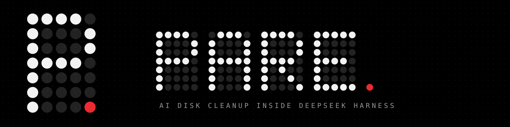
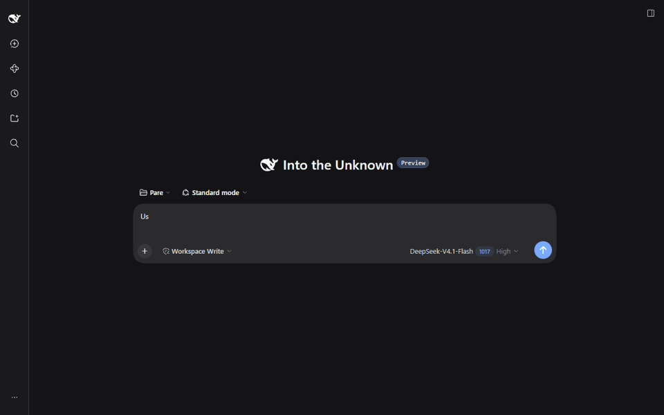
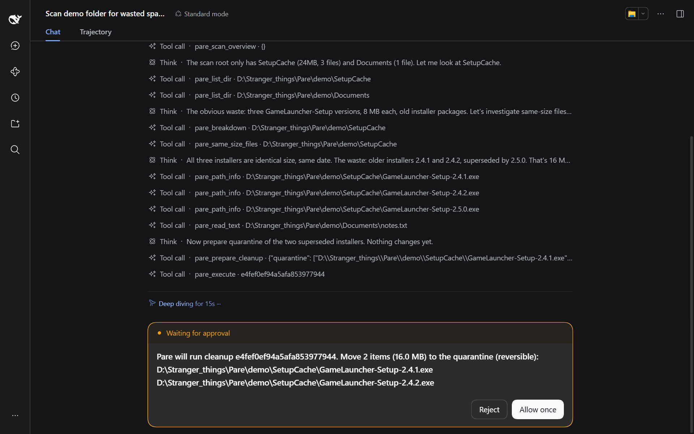
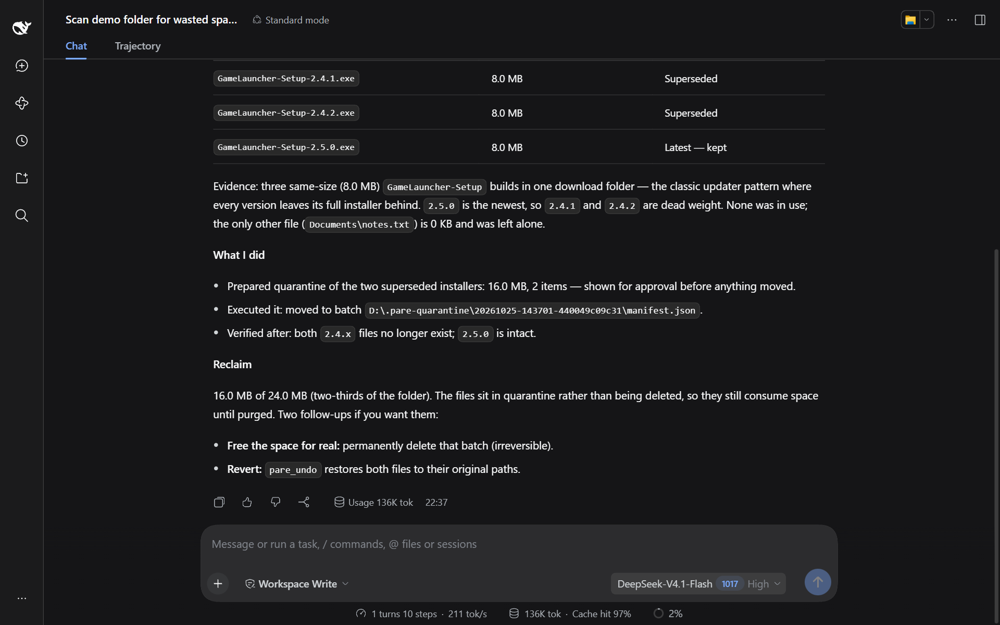

<p align="center">
  
</p>

<p align="center">
  <b>English</b> · <a href="README.zh-CN.md">简体中文</a> · <a href="README.zh-TW.md">繁體中文</a> · <a href="README.ja.md">日本語</a> · <a href="README.fr.md">Français</a> · <a href="README.de.md">Deutsch</a>
</p>

<p align="center">
  
  
  
  
  
</p>

Pare-DSH brings [Pare](https://github.com/DRAG0NM/Pare)'s AI disk investigation into DeepSeek Harness (DSH). The DSH agent investigates this machine's disk waste with Pare's read-only tools and prepares a cleanup. The scanning, investigation and cleanup are all done by the separate Pare core; the plugin only starts the core, registers the tools and asks for approval.

Nothing changes until you approve it in DSH's own approval prompt, and files are moved into a reversible quarantine rather than deleted.

<p align="center">
  
</p>
<p align="center"><sub>Recorded in a real DSH session on a demo folder.</sub></p>

## Install

```powershell
dsh plugin --profile web add @drag0nm/pare-dsh
```

Restart the profile (for example `dsh web`). No configuration is needed. On first start the plugin downloads the pinned Pare core and verifies it (see [The pinned core](#the-pinned-core)).

## A closer look

<table>
  <tr>
    <td width="50%"><br><sub><b>Approval</b> — the prompt lists the exact files before anything moves.</sub></td>
    <td width="50%"><br><sub><b>Result</b> — the agent's report after the cleanup, with what was kept and why.</sub></td>
  </tr>
</table>

## Tools

The plugin starts a long-lived `pare serve` process (protocol `pare.serve/1`, line-delimited JSON over stdio) and registers these tools. The scan index lives in that process, so run `pare_scan` before the investigation tools.

| Tool | What it does | Needs approval |
|---|---|:---:|
| `pare_scan` | Read-only scan of a drive or folder; keeps the index in the core process | No |
| `pare_scan_overview`, `pare_list_dir`, `pare_find_large_files`, `pare_same_size_files`, `pare_breakdown`, `pare_file_head`, `pare_read_text`, `pare_path_info`, `pare_installed_programs`, `pare_running_processes`, `pare_run_diagnostic` | Read-only investigation tools provided by the core. The list is requested from the core at startup (`hello`) and follows the core version | No |
| `pare_read_sensitive` | Reads files Pare marks as sensitive (keys, `.env`, browser login data, credential stores) | Yes, every time |
| `pare_prepare_cleanup` | Registers paths for quarantine and supported action templates, and returns a cleanup id. Nothing changes yet | No |
| `pare_execute` | Executes a prepared cleanup by id | Yes |
| `pare_list_quarantine` | Lists quarantine batches on local drives and their contents | No |
| `pare_undo` | Restores a quarantine batch to its original location, never overwriting a file that has taken the original path | Yes |
| `pare_purge` | Permanently deletes a quarantine batch to free space; cannot be undone | Yes |

The plugin offers no raw shell commands. DSH's own bash tool has its own approval.

## Approval and safety

The plugin listens to DSH's `tools/pre-execute` and answers `{kind: 'ask'}` for `pare_execute`, `pare_undo`, `pare_purge` and `pare_read_sensitive`. DSH asks you through its own approval service. Only a one-time `allowed-once` lets the call through; if you reject, cancel, or nobody is available to answer, the call is denied (fail closed). Every question is recorded in the session audit log.

- The approval prompt for `pare_execute` is built from the plan the plugin stored, listing the exact paths and template commands. It is not taken from the model's description.
- Unknown, expired and pre-rescan cleanup ids are denied without asking. A cleanup id can be executed at most once.
- Cancelling a running call stops the core process; the next call starts a new one, and `pare_scan` must be run again.

The core enforces its own checks, independent of the host:

- Protected locations are always refused.
- Every item carries evidence produced by `BuildSelected`.
- Before each file is moved, the executor re-checks its identity, whether it changed, and whether it is in use.
- Action templates are validated, the preview digest must match, and a preview expires after 30 minutes.
- The preview is marked as used before execution starts.
- `undo` and `purge` accept only manifests inside the Pare quarantine.

Privacy: investigation tools return paths and file names to the model (and its provider). The contents of sensitive files require your approval on every read.

## The pinned core

The `pareCore` entry in `package.json` pins the core for this plugin version: version 0.4.0, the download URL (the `pare-0.4.0-win-x64.exe` asset of the `v0.4.0` release of `DRAG0NM/Pare`) and its SHA-256, `23a09ed98b24642e80c1ee83d8a7464e6fa0df2ac1a1d6e078cd5882672001fb`.

When neither `parePath` nor `PARE_CORE_PATH` is set:

- The plugin uses `%LOCALAPPDATA%\Pare\core\pare-0.4.0.exe`, stored per user outside the plugin directory so reinstalling or upgrading the plugin does not lose it. If the file is missing, it is downloaded from the pinned URL: first with `curl.exe` from System32 (which honors `HTTPS_PROXY`), then, if that fails, with PowerShell's `Invoke-WebRequest` (which uses the Windows system proxy).
- The SHA-256 is verified after the download. The file is kept only if it matches; a mismatching download is deleted.
- The hash is verified again on every start and before every core process start. If the file has been modified, the plugin refuses to run (it never replaces it automatically) and the error says to delete the file so it is downloaded again.
- The version reported by `hello` must equal the pinned version; otherwise the plugin refuses it and registers no investigation tools.
- On some machines `AppData\Local` is EFS-encrypted and a rename within the directory is rejected (EXDEV), or an antivirus briefly holds the file. The plugin retries for a few seconds, then falls back to copying and deleting the temporary file; the final file must pass the same hash check.

For development, point `parePath` (plugin option) or the `PARE_CORE_PATH` environment variable at your own `pare.exe` (`go build -o pare.exe ./cmd/pare`). No hash check is done then; only the protocol name is checked.

For offline machines, place the same file (matching SHA-256) at `%LOCALAPPDATA%\Pare\core\pare-0.4.0.exe`, or set `parePath`.

`timeoutMs` is the per-call timeout, 600000 ms by default.

## Requirements

- Windows.
- DeepSeek Harness `0.2.1-rc.2` (Cordis `4.0.5`). Harness is still a developer preview and its interfaces may change incompatibly; Pare-DSH pins the peer version to the tool interface it was verified against, so re-test before upgrading.
- Node.js 22.19 or newer (DSH's own requirement).
- Access to GitHub on first start, to download the pinned core.

## Build from source

```powershell
pnpm install
pnpm check
dsh plugin --profile web add .
```

Verified end to end in DSH 0.2.1-rc.2, including reject, allow, undo and purge, and installing from npm.

## License

MIT, see [LICENSE](LICENSE). Dependency notes are in [THIRD_PARTY_NOTICES.md](THIRD_PARTY_NOTICES.md). The core is [Pare](https://github.com/DRAG0NM/Pare), also MIT.

## Official DSH resources

- [Official Harness repository and release status](https://github.com/deepseek-ai/deepseek-harness)
- [Official first-plugin guide](https://github.com/deepseek-ai/deepseek-harness/blob/master/docs/user/develop/basic/index.md)
- [Official tool authoring guide](https://github.com/deepseek-ai/deepseek-harness/blob/master/docs/user/develop/basic/tool.md)
- [Official plugin packaging guide](https://github.com/deepseek-ai/deepseek-harness/blob/master/docs/user/develop/basic/publish.md)
