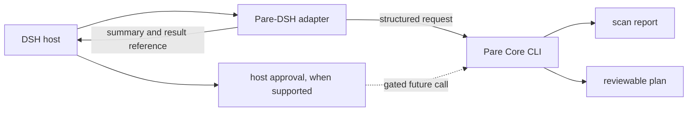

# Pare-DSH

**让 Agent 读懂磁盘报告；清理动作仍由用户掌控。**

Pare-DSH 是 DRAG0NM 的 Agent 插件项目，目标是把 Pare Core 的扫描和计划能力接入 DSH。仓库目前处于设计阶段；DSH 的 SDK、工具注册格式和审批接口尚未在本仓库验证，暂无可运行插件。

## 设计原则

- 插件只编排 Pare Core，不自行实现文件扫描、规则匹配或删除逻辑。
- 首版工具只提供扫描和计划预览；执行能力要等宿主审批接口通过验证后再开放。
- Agent 只能引用 Pare 生成的 plan ID，不把模型输出的任意路径传给执行器。
- 核心程序采用固定版本并校验摘要；不在运行时下载“最新版本”。
- 工具返回有范围的摘要和本地结果位置，避免把整份目录清单灌入对话。

## 数据流

接口契约、威胁边界和宿主接入检查见 [设计稿](docs/design.md)。

## 工具范围

| 工具 | 首版 | 行为 |
|---|---:|---|
| `disk_scan` | 规划中 | 运行只读扫描并返回摘要、缺口和结果位置 |
| `disk_plan` | 规划中 | 对扫描结果生成逐文件清理计划，不执行计划 |
| `disk_apply` | 关闭 | 宿主审批语义未验证前不得注册 |
| `disk_undo` | 关闭 | 撤回同样属于写操作，需独立审批和验证 |

## 安全

Pare-DSH 不向子进程传入模型构造的 shell 命令。插件检查核心程序版本和文件摘要，设置超时并限制输出大小。路径可能暴露用户目录信息；返回值默认摘要化，完整报告保存在本机。审批接口无法验证、核心版本不匹配或计划状态过期时，插件拒绝执行。

## 开发状态

| 项目 | 状态 |
|---|---|
| Pare Core CLI 契约 | 与 Pare 设计同步，未实现 |
| DSH SDK 与审批接口核验 | 未完成 |
| 只读工具 | 未实现 |
| 写工具 | 明确关闭 |
| 发布与安装流程 | 未设计完成 |

开发步骤见 [开发计划](docs/development-plan.md)。

## 关系与来源

Pare Core 由 [Pare](https://github.com/DRAG0NM/Pare) 仓库维护。插件通过版本化命令行接口调用核心，不把核心源码复制进本仓库。第三方 SDK 和依赖将在接入时按固定版本记录许可与来源。项目许可证尚未确定；仓库当前为私有。
