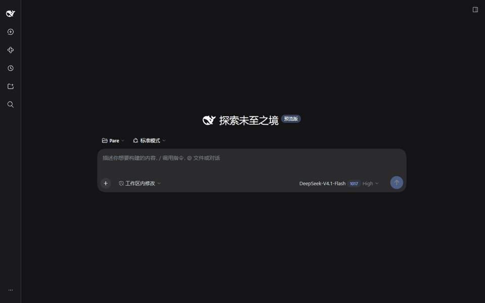
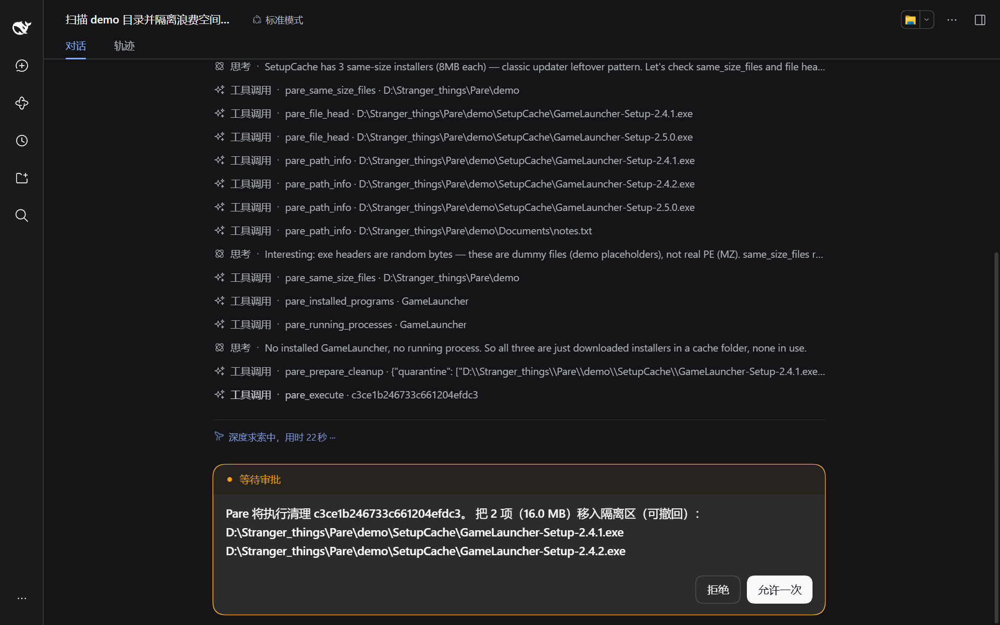
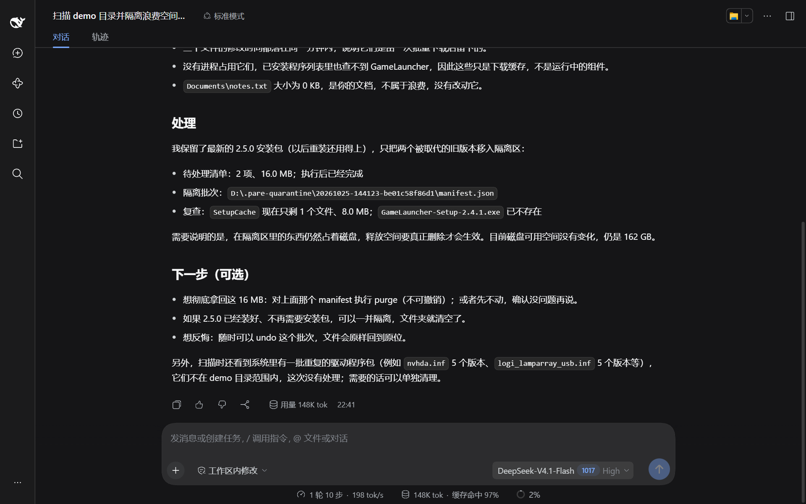

<p align="center">
  
</p>

<p align="center">
  <a href="README.md">English</a> · <a href="README.zh-CN.md">简体中文</a> · <b>繁體中文</b> · <a href="README.ja.md">日本語</a> · <a href="README.fr.md">Français</a> · <a href="README.de.md">Deutsch</a>
</p>

<p align="center">
  
  
  
  
  
</p>

Pare-DSH 把 [Pare](https://github.com/DRAG0NM/Pare) 的 AI 磁碟調查帶進 DeepSeek Harness（DSH）。DSH 裡的代理程式使用 Pare 的唯讀工具調查這台電腦上的磁碟浪費，並準備好清理方案。掃描、調查與清理都由獨立的 Pare 核心完成；外掛只負責啟動核心、註冊工具與發起核准。

在你於 DSH 自己的核准提示中同意之前，不會變更任何內容；檔案會被移入可復原的隔離區，而不是直接刪除。

<p align="center">
  
</p>
<p align="center"><sub>於真實的 DSH 工作階段中，以示範資料夾錄製。DSH 的介面僅提供英文與中文（簡體），因此畫面顯示的是簡體中文介面。</sub></p>

## 安裝

```powershell
dsh plugin --profile web add @drag0nm/pare-dsh
```

重新啟動該 profile（例如 `dsh web`）即可。不需要任何設定。首次啟動時，外掛會下載固定版本的 Pare 核心並加以驗證（見[固定版本的核心](#固定版本的核心)）。

## 細看

<table>
  <tr>
    <td width="50%"><br><sub><b>核准</b> —— 提示會在任何檔案移動之前列出確切的檔案。</sub></td>
    <td width="50%"><br><sub><b>結果</b> —— 清理後代理程式的報告，說明保留了什麼以及原因。</sub></td>
  </tr>
</table>

## 工具

外掛會啟動一個常駐的 `pare serve` 程序（協定 `pare.serve/1`，透過標準輸入輸出收發以行分隔的 JSON），並註冊下列工具。掃描索引保存在這個程序中，因此調查類工具必須先呼叫 `pare_scan`。

| 工具 | 作用 | 需要核准 |
|---|---|:---:|
| `pare_scan` | 唯讀掃描一個磁碟或資料夾，並在核心程序中保留索引 | 否 |
| `pare_scan_overview`、`pare_list_dir`、`pare_find_large_files`、`pare_same_size_files`、`pare_breakdown`、`pare_file_head`、`pare_read_text`、`pare_path_info`、`pare_installed_programs`、`pare_running_processes`、`pare_run_diagnostic` | 核心提供的唯讀調查工具。清單在外掛啟動時向核心查詢（`hello`），會隨核心版本變動 | 否 |
| `pare_read_sensitive` | 讀取被 Pare 標為敏感的檔案內容（金鑰、`.env`、瀏覽器登入資料、憑證庫） | 是，每次 |
| `pare_prepare_cleanup` | 登記要移入隔離區的路徑與受支援的動作範本，並回傳清理 id。此時不會變更任何內容 | 否 |
| `pare_execute` | 依 id 執行一份已準備好的清理 | 是 |
| `pare_list_quarantine` | 列出本機磁碟上的隔離批次及其內容 | 否 |
| `pare_undo` | 將一個隔離批次還原到原位置，不會覆蓋已佔用原路徑的檔案 | 是 |
| `pare_purge` | 永久刪除一個隔離批次以釋放空間，無法復原 | 是 |

外掛不提供原始 shell 指令。DSH 內建的 bash 工具有它自己的核准機制。

## 核准與安全

外掛會監聽 DSH 的 `tools/pre-execute`，對 `pare_execute`、`pare_undo`、`pare_purge` 與 `pare_read_sensitive` 回傳 `{kind: 'ask'}`。DSH 透過自己的核准服務詢問你：只有一次性的 `allowed-once` 才會放行；你拒絕、取消，或沒有可回答的一方時，呼叫一律被拒絕（失敗即關閉）。每次詢問都會記入工作階段稽核記錄。

- `pare_execute` 的核准提示由外掛儲存的方案產生，列出確切的路徑與範本指令，並非取自模型的描述。
- 未知、已過期，以及重新掃描之前的清理 id 會被直接拒絕，不會跳出詢問。一個清理 id 最多只能執行一次。
- 取消正在執行的呼叫會停止核心程序；下一次呼叫會啟動新的程序，必須重新執行 `pare_scan`。

核心端另有獨立的檢查，不依賴宿主：

- 受保護的位置一律拒絕。
- 每個項目都附帶 `BuildSelected` 產生的證據。
- 執行器在移動每個檔案之前，會重新檢查檔案身分、是否被變更、是否正被使用。
- 動作範本會經過驗證；預覽的 digest 必須相符；預覽在 30 分鐘後過期。
- 執行開始前，先將預覽標記為已使用。
- `undo` 與 `purge` 只接受 Pare 隔離區內的清單。

隱私：調查工具會把路徑與檔案名稱回傳給模型（以及其服務供應商）。敏感檔案的內容每次讀取都必須經過你的核准。

## 固定版本的核心

`package.json` 的 `pareCore` 固定了此外掛版本所使用的核心：版本 0.4.0、下載位址（GitHub `DRAG0NM/Pare` 的 `v0.4.0` 發行資產 `pare-0.4.0-win-x64.exe`）與 SHA-256 `23a09ed98b24642e80c1ee83d8a7464e6fa0df2ac1a1d6e078cd5882672001fb`。

未設定 `parePath` 與 `PARE_CORE_PATH` 時：

- 外掛使用 `%LOCALAPPDATA%\Pare\core\pare-0.4.0.exe`（依使用者儲存在外掛資料夾之外，重新安裝或升級外掛不會遺失）。檔案不存在時，會依固定位址下載：先使用 System32 中的 `curl.exe`（遵循 `HTTPS_PROXY`），失敗後再使用 PowerShell 的 `Invoke-WebRequest`（使用 Windows 系統 Proxy）。
- 下載完成後驗證 SHA-256，相符才保留；不相符的下載檔案會被刪除。
- 之後每次啟動，以及每次啟動核心程序之前，都會再次驗證雜湊。檔案被修改時外掛拒絕執行（不會自動取代），錯誤訊息會提示刪除該檔案以重新下載。
- `hello` 回傳的版本必須等於固定版本，否則外掛拒絕使用，也不會註冊任何調查工具。
- 在某些電腦上，`AppData\Local` 啟用了 EFS 加密，同一資料夾內的重新命名會被拒絕（EXDEV）；檔案被防毒軟體短暫佔用時也會被拒絕。外掛會重試數秒，仍不行就改為複製後刪除暫存檔，最終檔案同樣必須通過雜湊驗證。

開發時可以用 `parePath` 設定或環境變數 `PARE_CORE_PATH` 指向自行建置的 `pare.exe`（`go build -o pare.exe ./cmd/pare`）。此時不進行雜湊驗證，只檢查協定名稱。

離線環境可以將同一個檔案（SHA-256 一致）放到 `%LOCALAPPDATA%\Pare\core\pare-0.4.0.exe`，或設定 `parePath`。

`timeoutMs` 是單次呼叫的逾時時間，預設為 600000 毫秒。

## 系統需求

- Windows。
- DeepSeek Harness `0.2.1-rc.2`（Cordis `4.0.5`）。Harness 目前仍是 developer preview，介面可能出現不相容的變動；Pare-DSH 將 peer 版本固定在已驗證的工具介面上，升級前需先重新測試。
- Node.js 22.19 或更新版本（DSH 本身的需求）。
- 首次啟動時需要能連線到 GitHub，以下載固定版本的核心。

## 從原始碼建置

```powershell
pnpm install
pnpm check
dsh plugin --profile web add .
```

已在 DSH 0.2.1-rc.2 中完成端對端驗證，包括拒絕、允許、復原與永久刪除，以及從 npm 安裝。

## 授權

MIT，見 [LICENSE](LICENSE)。相依套件說明見 [THIRD_PARTY_NOTICES.md](THIRD_PARTY_NOTICES.md)。核心是 [Pare](https://github.com/DRAG0NM/Pare)，同樣採用 MIT 授權。

## DSH 官方資料

- [Official Harness repository and release status](https://github.com/deepseek-ai/deepseek-harness)
- [Official first-plugin guide](https://github.com/deepseek-ai/deepseek-harness/blob/master/docs/user/develop/basic/index.md)
- [Official tool authoring guide](https://github.com/deepseek-ai/deepseek-harness/blob/master/docs/user/develop/basic/tool.md)
- [Official plugin packaging guide](https://github.com/deepseek-ai/deepseek-harness/blob/master/docs/user/develop/basic/publish.md)
